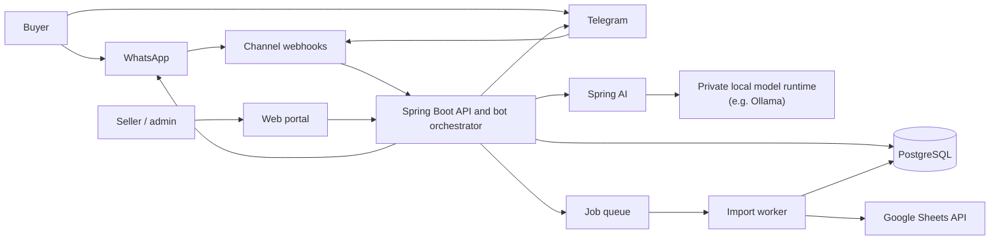

# Price Checker — Software Architecture

**Status:** Proposed first-release architecture  
**Date:** 15 October 2026

## 1. Product scope

Price Checker has three user surfaces:

- **Seller/admin web portal:** sellers upload a Google Sheet, maintain their own inventory, edit items, and replace their inventory with a new sheet. Admins can inspect all sellers, inventories, and cases.
- **WhatsApp and Telegram:** buyers ask for products and prices. The bot searches the shared catalog and returns matching sellers, prices, and availability.
- **AI assistance:** understands free-text requests, asks a follow-up when needed, and suggests reply buttons. Product facts and prices come from PostgreSQL, not from generated text.

## 2. Recommended first-release shape

Start with a **modular monolith** in Java using Spring Boot, Spring Security, Spring Data JPA, and PostgreSQL, with a separate worker process from the same codebase. Deploy the web/API process and worker independently, but keep one repository and one domain model. This is easier to build and operate than multiple microservices, while the module boundaries leave room to split out high-load components later.

**Initial deployment:** Spring Boot API, worker, PostgreSQL, and a private model runtime such as Ollama. The model runtime can run on the same machine for a small prototype or on a separate private GPU-capable server as usage grows. Spring AI sends inference requests to that private runtime over the internal network; it does not require an OpenAI or Anthropic account when configured with a local model. Add a managed Redis queue when imports or outbound messaging need retries and scheduling; for an early low-volume MVP, a PostgreSQL-backed job table can avoid an extra service. Use managed PostgreSQL with automated backups and point-in-time recovery when available. Keep the database and model runtime private and reachable only by the application and worker.

## 3. Application modules

| Module | Responsibilities |
|---|---|
| Identity and access | Login, password reset, session/JWT handling, roles, account status, seller ownership checks |
| Seller management | Seller profile, contact/channel details, onboarding and activation |
| Catalog and inventory | Products, seller-specific listings, price, stock/availability, search and manual edits |
| Sheet import | Google Sheets link validation, authorization, parsing, field mapping, preview, validation, replace-inventory transaction, import history |
| Cases | Buyer reports, unresolved requests, complaints, admin review and status changes |
| Channel adapters | WhatsApp and Telegram webhook verification, inbound normalization, outbound text/buttons, provider delivery status |
| Conversation and bot | Conversation state, intent handling, catalog search, disambiguation and response composition |
| AI gateway | Spring AI integration with a locally hosted model for intent extraction and natural-language wording; timeouts, concurrency limits, prompt/model version tracking, and graceful fallback when the model is unavailable |
| Notifications and jobs | Retryable sheet imports, outbound messages, webhook follow-up and cleanup tasks |
| Audit | Record admin actions, inventory changes, imports, account changes, and case resolution |

Keep channel-specific code inside adapters. The bot orchestrator should operate on a common internal message format so catalog and conversation logic do not depend on WhatsApp or Telegram SDK details.

## 4. Core data model

Use UUID primary keys and UTC timestamps. Store money as integer minor units (for example, kobo) plus an ISO currency code; do not use floating-point prices.

- **users**: `id`, `email/phone`, `password_hash`, `role` (`ADMIN`, `SELLER`), `status`, timestamps.
- **sellers**: `id`, `user_id`, `display_name`, `status`, `default_currency`, contact and channel identifiers.
- **products**: canonical product identity when useful: `id`, `name`, normalized name, brand/category, model.
- **inventory_items**: `id`, `seller_id`, optional `product_id`, seller SKU, name, model, description, price_minor, currency, availability/quantity, source row, timestamps, `is_active`.
- **sheet_imports**: `id`, `seller_id`, source URL/reference, status, row counts, validation summary, started/completed timestamps, initiating user.
- **sheet_import_rows**: import ID, row number, raw/normalized values, validation errors; retain only as long as needed for diagnosis/audit.
- **conversations**: channel, external chat/user ID, state JSON, last activity, optional linked user.
- **messages**: conversation, provider message ID, direction, message type, redacted content/metadata, delivery status, timestamp.
- **cases**: `id`, optional seller/conversation, category, description, status, assigned admin, timestamps.
- **audit_events**: actor, action, entity type/ID, safe before/after summary, timestamp.
- **jobs**: kind, payload, status, attempts, next run, lock/finish timestamps (if using PostgreSQL queue).

Useful constraints/indexes: unique `(seller_id, seller_sku)` when SKU is present; indexes on active inventory, normalized product name/model, seller, price, and case status. Add full-text or trigram search when basic matching is insufficient. Enforce seller ownership in service queries and optionally PostgreSQL row-level security as defense in depth.

## 5. Important flows

### Seller imports or replaces inventory

1. Seller signs in and submits a Google Sheets URL. The server checks that it is an accepted Google Sheets URL and stores it as an import request; never fetch arbitrary URLs (SSRF protection).
2. Require the sheet to be shared with a designated service identity or use a supported OAuth flow. A link alone does not grant the application access. Do not accept credentials in the URL.
3. Worker reads the sheet using the Google Sheets API, maps expected headers (`no.`, `name`, `model`, `description`, `price`, and agreed optional columns), and validates every row.
4. Show an import preview with valid/error row counts and let the seller correct data or confirm according to the product rule. Do not silently accept a partially invalid replacement.
5. On confirmation, use a database transaction to apply the new snapshot: upsert rows by seller SKU (or a documented stable key), mark removed listings inactive, and record the import. A failed import leaves the current inventory intact.
6. Publish an import result in the portal and audit the change. Manual edits use the same inventory services and update audit history.

Define whether re-upload means **replace all** or **merge/update**. Recommended default: full snapshot replacement for that seller, with soft deactivation of omitted products and a clear preview/confirmation.

### Buyer searches through WhatsApp or Telegram

1. Provider calls a verified webhook. Validate provider signatures/tokens and deduplicate by provider message ID.
2. Channel adapter normalizes the message and sends it to the conversation service.
3. Deterministic rules detect button replies and common commands. For natural language, Spring AI calls the private local model runtime to extract structured fields such as product/model, location, budget, and intent. Validate the result against a schema; if uncertain, ask a concise clarifying question with reply buttons. This inference stays within infrastructure you control.
4. Catalog service performs database search, applies active/availability filters, and ranks exact model/name matches above fuzzy matches. The AI must not invent stock, prices, or sellers.
5. Response formatter returns a concise list, with provider-supported buttons where useful. Send through the channel adapter and record delivery status.
6. If no match or buyer reports an issue, create or update a case for admin review.

### Admin and seller permissions

- **Admin:** view/manage all sellers, inventories, imports, and cases; actions are audited.
- **Seller:** manage only their own profile and inventory; cannot access other sellers' records or admin cases unless explicitly assigned a seller-facing case view.
- **Buyer:** no portal account required for basic bot search; only channel-scoped conversation information is available.
- Enforce authorization on every API endpoint, not only in the UI. Use pagination and filter validation on admin-wide lists.

## 6. API outline

Use `/api/v1` and JSON. Suggested route groups:

- `POST /auth/login`, `POST /auth/logout`, `POST /auth/refresh`
- `GET/PUT /seller/me`
- `GET/POST /seller/inventory`, `PATCH /seller/inventory/:id`, `POST /seller/inventory/imports`, `GET /seller/inventory/imports/:id`
- `POST /webhooks/whatsapp`, `POST /webhooks/telegram`
- `GET /admin/sellers`, `GET /admin/cases`, `PATCH /admin/cases/:id`, `GET /admin/imports`

Derive seller ID from the authenticated principal, never from an untrusted request body. Validate payloads at the edge and return stable error codes and request IDs.

## 7. Security, reliability, and operations

- Use HTTPS, secure password hashing (Argon2id or bcrypt), short-lived access tokens or secure server sessions, refresh-token rotation, CSRF protection for cookie-authenticated forms, and rate limits on login/webhooks/search.
- Store provider and AI secrets in the hosting platform's secret manager/environment; rotate them. Do not log tokens, passwords, full private sheet contents, or unnecessary buyer message content.
- Verify webhook signatures, use idempotency keys, and retry outbound messages with bounded exponential backoff. Keep failed jobs visible to admins/operators.
- Apply request size limits, schema validation, SQL parameterization, CORS allowlists, and security headers. Use least-privilege database credentials and separate migration credentials.
- Back up PostgreSQL, test restoration, monitor database connections, job failures, webhook errors, AI latency/cost, and channel delivery failures.
- Keep message retention configurable and collect only data needed for service and case resolution.

## 8. Technology recommendation

- **Backend:** Java + Spring Boot. Use Spring MVC for the API/webhooks, Spring Security for authentication/authorization, Spring Data JPA for persistence, and validation for request and import-row checks.
- **Database:** PostgreSQL. Use a query builder or ORM with migrations; keep important inventory search and transaction logic in explicit repository/service functions.
- **Queue:** PostgreSQL-backed jobs initially, or Redis with a Spring-compatible queue integration when retry volume/concurrency warrants it.
- **Portal:** React or another simple web UI, calling the versioned API. Admin and seller views share components but use role-gated navigation and server-side authorization.
- **Sheets:** Google Sheets API, with a dedicated service identity or OAuth. Provide a downloadable template and clear permissions instructions.
- **AI:** Spring AI connected to a self-hosted local model runtime such as Ollama. Use a local chat model for intent extraction and optionally a local embedding model for semantic search. Keep inference endpoints on a private network, do not configure cloud model credentials, and ensure the bot falls back to buttons/basic keyword search if the model is down. Spring AI is the Java integration layer; the local runtime and model perform the inference.
- **Hosting:** deploy API and worker as separate processes/containers; choose managed PostgreSQL near the application region. Final provider choice should consider budget, Nigeria latency, backups, connection pooling, and supported region availability.

## 9. Build sequence

1. Define inventory columns, uniqueness rule, currency, and replace-versus-merge behavior.
2. Build authentication, roles, seller records, and inventory CRUD with PostgreSQL migrations.
3. Implement sheet import preview, validation, atomic replacement, and import history.
4. Build admin seller/case views and seller inventory portal.
5. Add Telegram adapter and test the normalized bot flow; then add WhatsApp Cloud API integration and production webhook verification.
6. Deploy the local model runtime and add Spring AI intent extraction and suggested buttons after catalog search works deterministically. Measure response time and memory use with the selected model before choosing production hardware.
7. Add operational hardening: queue retries, monitoring, backups/restore test, audit review, rate limits, and retention policy.

## 10. Decisions to confirm during implementation

- Exact inventory columns and whether sellers provide a stable SKU/product ID.
- Whether duplicate product listings across sellers should be grouped into one result.
- Google Sheet access model: shared-to-service-account or OAuth per seller.
- Import rule: full replacement or merge; behavior for invalid rows and duplicate rows.
- Quantity/stock semantics and whether price comparison includes delivery/location.
- WhatsApp provider choice and whether the first release supports WhatsApp Cloud API directly.
- Hosting budget, preferred region, expected seller/product/message volume, and the hardware available for the local model runtime.
- Case types, status workflow, and what sellers can see about cases.

## 11. Key design choices

1. **Modular monolith first:** lower deployment and debugging cost for a solo/small team; modules provide a path to later extraction.
2. **AI assists; database decides:** all offers, prices, and stock come from current inventory records. The local model interprets requests but does not invent product facts.
3. **Imports are staged and atomic:** validation happens before replacing live inventory, and failure cannot erase the seller's current catalog.
4. **One channel-neutral bot core:** WhatsApp and Telegram differ only at their adapter boundary.

## References

- [Spring AI Ollama Chat](https://docs.spring.io/spring-ai/reference/api/chat/ollama-chat.html)
- [Spring AI Ollama Embeddings](https://docs.spring.io/spring-ai/reference/api/embeddings/ollama-embeddings.html)
