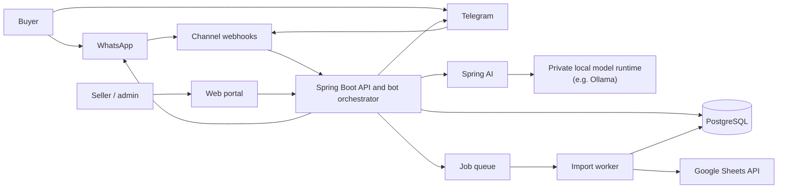

# Price Checker — Software Architecture

**Status:** Implemented inventory/catalog/Telegram MVP, with future architecture notes below
**Updated:** 22 October 2026

The current implementation runs Telegram long polling and durable reply processing inside the Spring Boot application, alongside the REST API. It uses the local Ollama chat API for request recognition and evidence-backed specification extraction, with fresh public manufacturer/Wikipedia lookups before product answers. Specifications, comparisons, prices and seller offer details use tables. Admin reference prices and seller averages come from PostgreSQL. The admin page at `/admin/index.html` manages reference prices and reads Telegram customer selections. WhatsApp, case management, a separate worker deployment and a full seller web portal remain planned. See [the Telegram implementation guide](docs/telegram-bot.md) for the implemented flow; the diagrams below describe the broader target architecture.

## 1. Product scope

The implemented Google Sheets integration downloads publicly shared CSV exports using HTTP GET. Sellers select Anyone with the link / Viewer and allow downloads; no Google credentials or write permissions are needed. Saving a sheet validates and imports its inventory into PostgreSQL. Sellers can delete owned database items without changing the original sheet. The optional preview/confirmation flow remains available, and inventory revisions prevent earlier previews from undoing later imports or deletions.

Price Checker has three user surfaces:

- **Seller/admin web portal:** sellers upload a Google Sheet, maintain their own inventory, edit items, and replace their inventory with a new sheet. Admins can inspect all sellers, inventories, and cases.
- **WhatsApp and Telegram:** buyers ask for products and prices. The bot searches the shared catalog and returns matching sellers, prices, and availability.
- **AI assistance:** understands free-text requests and answers specifications/comparisons from Ollama knowledge, with uncertainty qualified. Prices, catalog matches and seller availability come from PostgreSQL.

## 2. Recommended first-release shape

Start with a **modular monolith** in Java using Spring Boot, Spring Security, Spring Data JPA, and PostgreSQL, with a separate worker process from the same codebase. Deploy the web/API process and worker independently, but keep one repository and one domain model. This is easier to build and operate than multiple microservices, while the module boundaries leave room to split out high-load components later.



**Initial deployment:** Spring Boot API, worker, PostgreSQL, and a private model runtime such as Ollama. The model runtime can run on the same machine for a small prototype or on a separate private GPU-capable server as usage grows. Spring AI sends inference requests to that private runtime over the internal network; it does not require an OpenAI or Anthropic account when configured with a local model. Add a managed Redis queue when imports or outbound messaging need retries and scheduling; for an early low-volume MVP, a PostgreSQL-backed job table can avoid an extra service. Use managed PostgreSQL with automated backups and point-in-time recovery when available. Keep the database and model runtime private and reachable only by the application and worker.

## 3. Application modules

### Java package structure

Organize Java code by layer first, then by feature inside each layer. The base package remains `dot.kt.priceChecker`:

```text
dot.kt.priceChecker
|-- controllers
|   |-- sellers
|   |-- inventory
|   `-- imports
|-- service
|   |-- sellers
|   |-- inventory
|   |-- imports
|   `-- sheets
|-- repo
|   |-- sellers
|   |-- inventory
|   `-- imports
|-- entities
|   |-- sellers
|   |-- inventory
|   `-- imports
|-- dto
|   |-- sellers
|   |-- inventory
|   |-- imports
|   `-- sheets
|-- exceptions
|   |-- common
|   `-- sheets
|-- config
|   |-- security
|   `-- sheets
|-- enums
|   `-- imports
`-- utils
    `-- sheets
```

Controllers handle HTTP requests and delegate business operations to services. Services own business rules and transactions, repositories handle persistence, and entities map database tables. DTOs carry request/response and intermediate data. Exceptions and the global exception handler live under `exceptions`; Spring configuration lives under `config`. Keep stateless URL validation helpers under `utils`.

Tests mirror the corresponding production packages under `src/test/java`. Add feature packages such as `users` within the relevant layers when that feature is implemented. Keep the application entry point at the base package so Spring discovers all layers.

### Module responsibilities

| Module | Responsibilities |
|---|---|
| Identity and access | Login, password reset, session/JWT handling, roles, account status, seller ownership checks |
| Seller management | Seller profile, contact/channel details, onboarding and activation |
| Catalog and inventory | Products, seller-specific listings, price, stock/availability, search and manual edits |
| Sheet import | Google Sheets link validation, authorization, parsing, field mapping, preview, validation, replace-inventory transaction, import history |
| Cases | Buyer reports, unresolved requests, complaints, admin review and status changes |
| Channel adapters | WhatsApp and Telegram webhook verification, inbound normalization, outbound text/buttons, provider delivery status |
| Conversation and bot | Conversation state, intent handling, catalog search, disambiguation and response composition |
| AI gateway | Spring AI integration with a locally hosted model for intent extraction and natural-language wording; timeouts, concurrency limits, prompt/model version tracking, and graceful fallback when the model is unavailable |
| Notifications and jobs | Retryable sheet imports, outbound messages, webhook follow-up and cleanup tasks |
| Audit | Record admin actions, inventory changes, imports, account changes, and case resolution |

Keep channel-specific code inside adapters. The bot orchestrator should operate on a common internal message format so catalog and conversation logic do not depend on WhatsApp or Telegram SDK details.

## 4. Core data model

Use UUID primary keys and UTC timestamps. Store money as integer minor units (for example, kobo) plus an ISO currency code; do not use floating-point prices.

- **app_users**: `id`, `email`, `password_hash`, `role` (`ADMIN`, `MANAGER`, `SELLER`, `USER`), `enabled`, `token_version`, optimistic-lock revision, timestamps. Seller profiles share the account UUID. Only SELLER self-registration is currently exposed.
- **sellers**: `id`, `user_id`, `display_name`, `status`, `default_currency`, contact and channel identifiers.
- **items**: implemented shared identity with category, name, brand, normalized brand key, model/variant, and a unique normalized definition hash. Abstract Java `Item` uses joined inheritance.
- **gadget_items**: implemented `Gadget` subtype with gadget type and optional phone series; its ID references `items`. V7 migrates existing phone records without changing IDs.
- **electrical_appliance_items**: implemented `ElectricalAppliance` subtype with appliance type, size/capacity, and features; its ID references `items`.
- **inventory_items**: `id`, `seller_id`, optional `item_id`, seller SKU, name, model, description, optional free-text condition (`item_condition`), price_minor, currency, availability/quantity, source row, timestamps, `active`. Prices and condition belong to each seller's offer, separately from shared item identity.
- **sheet_imports**: `id`, `seller_id`, source URL/reference, status, row counts, validation summary, started/completed timestamps, initiating user.
- **sheet_import_rows**: import ID, row number, raw/normalized values, validation errors; retain only as long as needed for diagnosis/audit.
- **telegram_users**, **telegram_conversations**, **telegram_updates**: implemented profiles, state/activity/selection history and durable processing/delivery receipts. Telegram identities do not create privileged app accounts.
- **price_checker_intel**: implemented admin reference prices per item and currency, with source notes and update attribution.
- **messages**: conversation, provider message ID, direction, message type, redacted content/metadata, delivery status, timestamp.
- **cases**: `id`, optional seller/conversation, category, description, status, assigned admin, timestamps.
- **audit_events**: actor, action, entity type/ID, safe before/after summary, timestamp.
- **jobs**: kind, payload, status, attempts, next run, lock/finish timestamps (if using PostgreSQL queue).

Useful constraints/indexes: unique `(seller_id, seller_sku)` when SKU is present; indexes on active inventory, normalized product name/model, seller, price, and case status. Add full-text or trigram search when basic matching is insufficient. Enforce seller ownership in service queries and optionally PostgreSQL row-level security as defense in depth.

## 5. Important flows

### Seller imports or replaces inventory

1. Seller signs in and saves an accepted Google Sheets URL using `PUT /api/v1/seller/me/sheet`. The server constructs a Google CSV export URL; arbitrary download hosts are rejected.
2. The sheet must allow Anyone with the link / Viewer and viewer downloads. The integration uses HTTP GET without Google credentials and never changes the source sheet.
3. The request reads the sheet synchronously, maps headers (`sku` or `no.`, `name`, `model`, `description`, `condition`, `price`, `currency`, `quantity`), and validates every row before applying changes.
4. Valid data is imported immediately: a transaction locks the seller, checks the inventory revision, upserts products by seller SKU, deactivates omitted products, completes the import record, and saves the link. Invalid data leaves the previous link and inventory unchanged and returns row errors.
5. The separate preview/confirmation endpoints remain available for reviewing a snapshot before applying it. Confirmations reject previews made before a later import or item deletion.
6. `GET /api/v1/seller/inventory` reads PostgreSQL. `DELETE /api/v1/seller/inventory/{id}` deletes an owned database item without contacting Google. The source sheet and import history remain available.

Re-import uses full snapshot replacement for that seller. An explicit new import or re-save can restore a deleted product still present in the sheet. Reading the source sheet does not import it, and no background synchronization runs.

### Buyer searches through WhatsApp or Telegram

The implemented catalog API supports gadgets -> gadget type -> brand -> optional phone series -> exact item, or electrical appliances -> brand -> type/size/features -> exact model. The implemented Telegram flow asks for a name, domain/type and free-text request, then uses Ollama to identify models and answer product questions. Prices use admin intel before seller averages. Customers can browse sellers and save a selection for admin lookup. See [the catalog guide](docs/item-catalog.md) and [Telegram guide](docs/telegram-bot.md). The following webhook/case workflow remains a future WhatsApp architecture proposal.

1. Provider calls a verified webhook. Validate provider signatures/tokens and deduplicate by provider message ID.
2. Channel adapter normalizes the message and sends it to the conversation service.
3. Deterministic rules detect button replies and common commands. For natural language, Spring AI calls the private local model runtime to extract structured fields such as product/model, location, budget, and intent. Validate the result against a schema; if uncertain, ask a concise clarifying question with reply buttons. This inference stays within infrastructure you control.
4. Catalog service performs database search, applies active/availability filters, and ranks exact model/name matches above fuzzy matches. The AI must not invent stock, prices, or sellers.
5. Response formatter returns a concise list, with provider-supported buttons where useful. Send through the channel adapter and record delivery status.
6. If no match or buyer reports an issue, create or update a case for admin review.

### Admin and seller permissions

- **Admin:** view/manage all sellers, inventories, imports, and cases; actions are audited.
- **Seller:** manage only their own profile and inventory; cannot access other sellers' records or admin cases unless explicitly assigned a seller-facing case view.
- **Buyer:** no portal account required for basic bot search; only channel-scoped conversation information is available.
- Enforce authorization on every API endpoint, not only in the UI. Use pagination and filter validation on admin-wide lists.

## 6. API outline

Use `/api/v1` and JSON. Suggested route groups:

- `POST /auth/login`, `POST /auth/logout`, `POST /auth/refresh`
- `GET/PUT /seller/me`
- `GET/POST /seller/inventory`, `PATCH /seller/inventory/:id`, `POST /seller/inventory/imports`, `GET /seller/inventory/imports/:id`
- `POST /webhooks/whatsapp`, `POST /webhooks/telegram`
- `GET /admin/sellers`, `GET /admin/cases`, `PATCH /admin/cases/:id`, `GET /admin/imports`

Services derive the current account ID through `CurrentUserService`; controllers accept DTOs and do not receive `Principal` or `Authentication`. Services authorize ownership before accessing target seller records. Validate payloads at the edge and return stable error codes and request IDs.

The implemented security flow uses Spring Security's filter chain and OAuth2 resource-server JWT validation, with an application login endpoint issuing 3-hour RS256 tokens. Roles map to explicit service permissions. ADMIN can read/write across accounts; MANAGER has project read permissions only; SELLER and USER receive only their permitted self-service operations. Tokens contain an immutable account UUID and revocation version; enabled status and authorities are loaded from the live account. The management API exposes global reads and Admin mutations. Seller registration always assigns SELLER, and privileged roles require trusted provisioning.

## 7. Security, reliability, and operations

- Use HTTPS, secure password hashing (Argon2id or bcrypt), short-lived access tokens or secure server sessions, refresh-token rotation, CSRF protection for cookie-authenticated forms, and rate limits on login/webhooks/search.
- Store provider and AI secrets in the hosting platform's secret manager/environment; rotate them. Do not log tokens, passwords, full private sheet contents, or unnecessary buyer message content.
- Verify webhook signatures, use idempotency keys, and retry outbound messages with bounded exponential backoff. Keep failed jobs visible to admins/operators.
- Apply request size limits, schema validation, SQL parameterization, CORS allowlists, and security headers. Use least-privilege database credentials and separate migration credentials.
- Back up PostgreSQL, test restoration, monitor database connections, job failures, webhook errors, AI latency/cost, and channel delivery failures.
- Keep message retention configurable and collect only data needed for service and case resolution.

## 8. Technology recommendation

- **Backend:** Java + Spring Boot. Use Spring MVC for the API/webhooks, Spring Security for authentication/authorization, Spring Data JPA for persistence, and validation for request and import-row checks.
- **Database:** PostgreSQL. Use a query builder or ORM with migrations; keep important inventory search and transaction logic in explicit repository/service functions.
- **Queue:** PostgreSQL-backed jobs initially, or Redis with a Spring-compatible queue integration when retry volume/concurrency warrants it.
- **Portal:** React or another simple web UI, calling the versioned API. Admin and seller views share components but use role-gated navigation and server-side authorization.
- **Sheets:** read-only public CSV exports with Viewer/download access. Provide a downloadable template and clear permissions instructions. Private-sheet authentication would require a separate future integration.
- **AI:** Spring AI connected to a self-hosted local model runtime such as Ollama. Use a local chat model for intent extraction and optionally a local embedding model for semantic search. Keep inference endpoints on a private network, do not configure cloud model credentials, and ensure the bot falls back to buttons/basic keyword search if the model is down. Spring AI is the Java integration layer; the local runtime and model perform the inference.
- **Hosting:** deploy API and worker as separate processes/containers; choose managed PostgreSQL near the application region. Final provider choice should consider budget, Nigeria latency, backups, connection pooling, and supported region availability.

## 9. Build sequence

1. Define inventory columns, uniqueness rule, currency, and replace-versus-merge behavior.
2. Build authentication, roles, seller records, and inventory CRUD with PostgreSQL migrations.
3. Implement sheet import preview, validation, atomic replacement, and import history.
4. Build admin seller/case views and seller inventory portal.
5. Add Telegram adapter and test the normalized bot flow; then add WhatsApp Cloud API integration and production webhook verification.
6. Deploy the local model runtime and add Spring AI intent extraction and suggested buttons after catalog search works deterministically. Measure response time and memory use with the selected model before choosing production hardware.
7. Add operational hardening: queue retries, monitoring, backups/restore test, audit review, rate limits, and retention policy.

## 10. Decisions to confirm during implementation

- Exact inventory columns and whether sellers provide a stable SKU/product ID.
- Whether duplicate product listings across sellers should be grouped into one result.
- Whether a future release should support private sheets using a service identity or seller OAuth with read-only scopes.
- Import rule: full replacement or merge; behavior for invalid rows and duplicate rows.
- Quantity/stock semantics and whether price comparison includes delivery/location.
- WhatsApp provider choice and whether the first release supports WhatsApp Cloud API directly.
- Hosting budget, preferred region, expected seller/product/message volume, and the hardware available for the local model runtime.
- Case types, status workflow, and what sellers can see about cases.

## 11. Key design choices

1. **Modular monolith first:** lower deployment and debugging cost for a solo/small team; modules provide a path to later extraction.
2. **AI assists; database decides:** all offers, prices, and stock come from current inventory records. The local model interprets requests but does not invent product facts.
3. **Imports are staged and atomic:** validation happens before replacing live inventory, and failure cannot erase the seller's current catalog.
4. **One channel-neutral bot core:** WhatsApp and Telegram differ only at their adapter boundary.

## References

- [Spring AI Ollama Chat](https://docs.spring.io/spring-ai/reference/api/chat/ollama-chat.html)
- [Spring AI Ollama Embeddings](https://docs.spring.io/spring-ai/reference/api/embeddings/ollama-embeddings.html)
